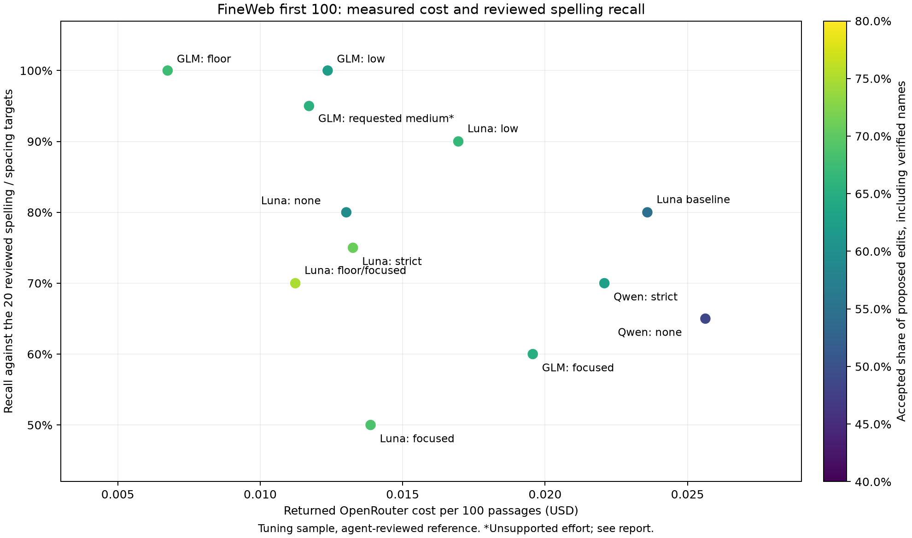

# FineWeb annotation profile evaluation — November 11, 2026

The best tested configuration for ordinary spelling and word-spacing targets was **`z-ai/glm-5.3-flash:floor`, low reasoning, temperature 0, and the strict prompt**. It cost **$0.00675 per 100 passages**, 71.4% below the Luna baseline, and found **20/20 independently reviewed targets**, versus Luna’s 16/20. Its accepted share of proposed edits rose from 54.5% to 67.6%. This is an improvement on this sample, with substantial remaining contamination: **23 accepted edits, 10 outside scope or wrong, and one uncertain edit** out of 34 proposals.

The [default configuration](../config/prepare_fineweb.yaml) now uses the exact winning GLM settings as the sole built-in profile. The tested Luna strict-prompt, low-reasoning configuration reached 18/20 target recall, 20/30 accepted proposals, and 28.1% lower cost than its baseline. These results remain historical comparisons; neither model produced clean training labels without further review.

**The comparison used the requested first 100 entries.** I streamed `HuggingFaceFW/fineweb`, `sample-10BT`, `train`, without shuffling or skipping, froze the complete passages once, and reused them across all runs. There were 282,561 characters, with a longest passage of 33,891 characters; no passage was shortened. All 100 texts were distinct. Each run used **two workers and ten entries per shard**, with **at most two runs active**, so there were at most four annotation workers in total. Twelve full configurations completed, plus two unsuccessful pilots. Sub-agents separately reviewed the pipeline, researched official pricing, read every source passage before seeing results, and adjudicated model proposals.

The baseline means the original prompt and server-default reasoning, with an 8,192-token cap, 180-second timeout, and temperature omitted for Luna because its advertised parameters do not support it. It is a bounded reference run rather than an exact replay of the then-current unbounded default YAML. Live runs loaded `.env.local` and confirmed the OpenRouter endpoint.

The input was the first 100 entries in streaming order from `HuggingFaceFW/fineweb`, `sample-10BT`, `train`. The frozen input SHA-256 is `64654e5e16dbe5ab50d3c681655cb419ba6e23d0a2fb0cff5cb2d13c4a030a57`. The separate manifest and review JSON artifacts were removed when this report and its plots were consolidated into `specs`.

**Accuracy here has a deliberately stated scope.** The independent source reading found 14 clear nonword typos and six clear word-space errors. Those 20 occurrences form the recall reference, including `tje → the`, `yaught → yacht`, `hyrdologists → hydrologists`, `asbatteries → as batteries`, and `clubchampionship → club championship`. Verified misspelled entity names count as additional accepted edits, separately from the 20-target reference. Grammar, punctuation, capitalization, intentional wordplay, accepted compounds, and page-extraction repair are outside the narrow spelling policy. Real-word substitutions are also reported outside that policy; some are useful corrections and could belong in a broader contextual spell checker. Their exclusion is a task-definition choice, not proof that they are always bad suggestions.

“Accepted / proposed” includes verified entity repairs and keeps uncertain proposals in the denominator. It is a conservative reviewed precision figure, not passage-level accuracy. “Usable” includes successful empty results and partial results; failed `annotations: null` results remain failures, never clean negatives.

| Configuration | Cost / 100 | Targets found / 20 | Accepted / proposed | Outside scope or wrong; uncertain | Usable / 100 |
|---|---:|---:|---:|---:|---:|
| Luna, original prompt, default reasoning | $0.02359 | 16/20 | 24/44 (54.5%) | 17; 3 | 100 |
| Qwen 27B, original prompt, none | $0.02563 | 13/20 | 17/35 (48.6%) | 17; 1 | 99 |
| Qwen 27B, strict prompt, none | $0.02208 | 14/20 | 15/24 (62.5%) | 8; 1 | 97 |
| Luna, original prompt, none | $0.01302 | 16/20 | 19/32 (59.4%) | 12; 1 | 100 |
| Luna, strict prompt, none | $0.01325 | 15/20 | 17/24 (70.8%) | 7; 0 | 99 |
| Luna, strict prompt, low | $0.01695 | 18/20 | 20/30 (66.7%) | 8; 2 | 100 |
| GLM Flash, strict prompt, low | $0.01237 | 20/20 | 23/37 (62.2%) | 14; 0 | 100 |
| GLM Flash, strict prompt, requested medium* | $0.01171 | 19/20 | 21/32 (65.6%) | 11; 0 | 100 |
| GLM Flash :floor, strict prompt, low | $0.00675 | 20/20 | 23/34 (67.6%) | 10; 1 | 100 |
| Luna, focused prompt, none | $0.01387 | 10/20 | 11/16 (68.8%) | 5; 0 | 100 |
| GLM Flash, focused prompt, low | $0.01957 | 12/20 | 13/20 (65.0%) | 7; 0 | 95 |
| Luna :floor, focused prompt, none | $0.01123 | 14/20 | 15/20 (75.0%) | 5; 0 | 99 |



Every proposal in the completed JSONL shards was inspected against its source context and adjudicated; equivalent edits with unchanged surrounding text were normalized to the same transformation. The table above summarizes the reviewed results; the winning run’s complete rejected/outside-scope edit list appears below.

**The strongest gains came from model choice and actual routing prices.** GLM’s ordinary low-reasoning route already found all 20 reference targets for $0.01237. Adding `:floor` retained all 20, reduced proposals from 37 to 34, and cut actual cost another 45.4%. It generated more reasoning tokens, 8,906 versus 4,279, yet cost less because the serving prices changed. The winning run took 81.3 seconds, versus 280.6 seconds for the Luna baseline, at the same worker count.

There is a real entity tradeoff: the winning GLM run made three verified entity repairs, while Luna’s baseline made eight. Thus 20/20 reference recall does not mean every kind of spelling error was recovered. Across all runs we verified nine distinct entity repairs; that supplementary candidate-derived set is not an exhaustive independent entity benchmark.

**Explicit reasoning settings helped control spending.** Luna’s baseline used 20,844 reasoning tokens and 106 requests. Disabling reasoning with the original prompt used zero reasoning tokens and 101 requests, cutting cost from $0.02359 to $0.01302. Overall reference recall stayed 16/20, but the misses changed: lexical recall fell from 13/14 to 11/14 while spacing recall rose from 3/6 to 5/6. Low reasoning with the strict prompt restored lexical recall to 13/14 and reached 18/20 overall. For Qwen, disabling its expensive default reasoning was essential, although its full runs remained weaker than the recommended GLM configuration.

The run labeled “medium” sent `reasoning.effort=medium` and found 19/20 targets with 21 accepted proposals out of 32. **Correction after checking the official model card:** GLM-5.3-Flash supports only `low`, `high`, and `max`; the author says unsupported values default to `max`. A routed provider might translate the request, but the observed token usage does not establish that it did. This run must not be treated as a validated medium-reasoning experiment or evidence about increasing effort. The default configuration uses the supported `low` value. See the [official model card](https://huggingface.co/zai-org/GLM-5.3-Flash#introduction).

**More restrictive prompting did not reliably improve quality.** The strict prompt defines spelling versus grammar, preserves names and specialist compounds, requests minimal exact context, and favors the smallest edit. Adding an even stronger exclusion checklist and explicit negative examples—the “focused” prompt—reduced recall severely. Luna fell to 10/20 reference targets; GLM fell to 12/20. Both still proposed non-spelling edits. GLM’s focused run needed 131 requests, yielded five unusable passages, and cost $0.01957, more than its successful strict run. It missed obvious words including `Inernet`, `desination`, and `hyrdologists`. That prompt was not selected for the default configuration.

Minimal context is included in the winning prompt, but it was not tested as an isolated factor, and retry counts did not improve uniformly across models. I retained strict exact matching and conflict rejection; accepting approximate context would hide localization errors rather than establish that an edit was right.

The `:floor` Luna run used the same focused prompt and settings as the ordinary focused run. It cost $0.01123 versus $0.01387, a 19.0% saving, but took 442.6 versus 65.6 seconds. Its output also differed: 14/20 reference targets versus 10/20. Cheaper routing can involve different providers, latency, caches and outputs; it is not a guaranteed half-price substitute with identical quality.

**Two pilots were unsuccessful and are excluded from the full-run table.** Qwen 27B with its original default reasoning produced 53,379 reasoning tokens in ten recorded completions spanning source indices 0–7. Two responses hit the 8,192-token cap and triggered retries. I interrupted this pilot after $0.12995 of reported charges; it was already more expensive than five full Qwen runs with reasoning disabled. Qwen was still evaluated on all 100 entries in both completed no-reasoning configurations. Capping tokens alone was not a useful fix for an excessive reasoning default.

`qwen/qwen3.7-flash` had attractive advertised rates, but its first shard encountered provider 429 errors and exhausted the retry budget. The recorded responses also attempted numerous apostrophe edits and ambiguous contexts despite the spelling-only prompt. No full shard completed, so there is no comparable 100-entry accuracy score. I did not select it based on its low advertised price.

**The remaining mistakes are meaningful, not just formatting failures.** Examples from the inspected outputs:

| Proposed edit | Assessment |
|---|---|
| `tje → the`, `definately → definitely`, `aquire → acquire` | Genuine lexical spelling errors. |
| `asbatteries → as batteries`, `LauraMeyocks → Laura Meyocks` | Clear accidental word joins under the spacing policy. |
| `lead → led`, `appear → appearing`, deleting `with with` | Inflection, agreement or repeated-word editing. |
| `complimented → complemented`, `wiling → willing` | Real-word substitutions; useful in a broader task, excluded from the narrow reference. |
| `rsp → RSP`, `havent → haven't`, `onesided → one-sided` | Capitalization or punctuation/hyphenation changes. |
| `handsink → hand sink` | An established specialist compound; splitting it is unnecessary normalization. |
| `Malmborg → Malmbourg` | A harmful name correction: it changes the correct surname to the passage’s more frequent incorrect form. |
| `Cleireican → Cleireachan` | A wrong entity repair; the documented surname is O’Cleireacain. |
| `by Russ → virus`, `sis → prognosis` | Destroys deliberate child-voice wordplay; the latter yields “frog knows prognosis.” |
| `and → alcohol` | A harmful rewrite from GLM’s ordinary low run, yielding “consume alcohol alcohol.” |
| `chased-after → chaste-after` | A wrong rewrite from Luna without reasoning. |
| `Adwars → AdWords` | Uncertain: it may replace an intentional advertising-war label with an unrelated product name. |

These examples were checked in context. The correct **Malmborg** spelling is supported by the [Maine Sheriffs’ Association’s 2012 publication](https://www.mainesheriffs.org/_files/ugd/ce6fae_23ee22dbb11043a4af4d4025c8dc3422.pdf), and **O’Cleireacain** by [New York City’s contemporary finance report](https://www.nyc.gov/assets/finance/downloads/pdf/reports/reports-tax-expenditure/ter_1991_final.pdf). Official [King County food-service plan-review guidance](https://kingcounty.gov/-/media/king-county/depts/dph/documents/certificates-permits-licenses/food-worker-business-permits/permanent-businesses/plan-guide-food-service-plan-review.pdf) uses “handsinks.”

**Some ambiguity survives any reasonable prompt.** Intentional names and fandom nicknames can resemble typos; a name’s majority spelling need not be the correct one. Real-word typing slips overlap with grammar and word choice. Informal variants such as `bungie` and `miniscule` depend on the chosen lexicon. Missing spaces in ordinary prose overlap with HTML extraction damage, while quotation and wordplay can intentionally preserve unusual spelling. Those cases require a stated annotation policy or outside evidence. I would not call all observed mistakes unavoidable: deleting repeated words, changing punctuation, and emitting `and → alcohol` were avoidable failures to follow the task. The experiments show that these models still make them.

**Prices were checked against OpenRouter, then measured from returned usage.** The starting [live model catalog](https://openrouter.ai/api/v1/models) listed these USD rates per million tokens:

| Model | Input | Output |
|---|---:|---:|
| `openai/gpt-6-luna` | $0.10 | $0.50 |
| `qwen/qwen3.8-27b` | $0.15 | $1.875 |
| `z-ai/glm-5.3-flash` | $0.0399 | $0.0784 |
| `qwen/qwen3.7-flash` | $0.03 | $0.13 |

Actual endpoint prices vary. [Luna’s endpoint catalog](https://openrouter.ai/api/v1/models/openai/gpt-6-luna/endpoints) included a flex tier at $0.05/$0.25. Qwen’s [endpoint catalog](https://openrouter.ai/api/v1/models/qwen/qwen3.8-27b/endpoints) likewise showed materially different provider rates. The `:floor` shortcut sorts by price and permits flex endpoints; see [OpenRouter’s provider-routing documentation](https://openrouter.ai/docs/guides/routing/provider-selection). It does not guarantee the lowest headline rate on every request. Luna’s advertised supported parameters omit temperature, so the tested Luna configurations omitted it. Reasoning must be disabled or reduced explicitly where supported; merely hiding reasoning does not stop its billing, as explained in [OpenRouter’s reasoning documentation](https://openrouter.ai/docs/guides/best-practices/reasoning-tokens).

Every table cost sums `usage.cost` from all requests in that completed run, including validation retries. All completed-run requests supplied cost information; no token-price estimate was substituted. [OpenRouter’s usage documentation](https://openrouter.ai/docs/cookbook/administration/usage-accounting) describes these fields. Provider identity, token usage, cache usage, response content and elapsed time were recorded per call. Caches and provider mix can change future costs. Across all full runs and pilots, recorded returned-completion charges total **$0.32051**. That is a lower bound: interrupted in-flight requests or error charges without usage may be missing, and assistant/sub-agent operation is not included. The experiment recorded 1,311 requests, including five request errors; the winning run used 102 requests with reported usage.

**Implementation stayed within the existing architecture.** The provider accepts optional `reasoning_effort` and nullable temperature. The CLI, structured correction schema, exact resolver, retry policy, output types and sharding architecture are unchanged. During the experiment, a one-off runner called the production provider and batching code, adding request recording and bypassing local annotation caching so every configuration was measured afresh. The winning annotation settings and worker/shard limits are now folded into the default Hydra configuration; the one-off runner and alternative profiles have been removed.

With `MODEL_ENDPOINT` and `MODEL_TOKEN` set to OpenRouter, use the recommended configuration with a fresh output directory:

```sh
uv run prepare-fineweb output=data/fineweb-recommended
```

The default configuration uses `take=100`, `workers=2`, `shard_size=10`, three attempts, an 8,192-token completion cap, and a 180-second request timeout. Optional top-p and seed are omitted. The successful full comparisons mostly used that same cap; focused Luna runs used 1,024, focused GLM and medium GLM used 2,048. These were not a complete factorial experiment, so prompt/cap/provider effects should not be treated as perfectly isolated.

The frozen passages, raw completions, resolved configurations, JSONL shards, request metadata and logs were stored under `data/prepare-fineweb-research-20261111/` (ignored by Git); any local copy remains untouched by this cleanup. Only this report and the comparison plots are retained in the repository from the experiment. An [exportable SVG](assets/fineweb_annotation_profile_evaluation/comparison.svg) accompanies the PNG above. At the time of the experiment, Ruff, ty and all **74 tests** passed, and the tested presets were resolved through Hydra and validated against their recorded benchmark configurations.

These are tuning-sample findings. The same first 100 entries informed the prompt iterations and the scores, there were only 20 core targets, judgments were made by Codex agents rather than an external human gold-labeling exercise, and each configuration ran once. One reference mistake changes recall by five percentage points. The result supports choosing the GLM configuration for this narrow target and cost budget; it does not establish 100% spelling recall on FineWeb generally, complete entity recall, or production-ready annotation precision.


**Follow-up: model size, exact failure denominator, and full-subset cost**

The tested model is **GLM-5.3-Flash: approximately 320 billion total parameters, with 18 billion active per token**, using a mixture-of-experts architecture. The publisher’s [official model card](https://huggingface.co/zai-org/GLM-5.3-Flash#introduction) gives those figures; Hugging Face’s tensor inventory rounds the stored model to 321B. “Flash” describes its efficient serving variant, not a dense 18B model. Sparse activation reduces computation per token; it does not mean all weights fit in the memory needed by a dense 18B model. As a rough weights-only calculation, 320B parameters require about 640GB at BF16 or 320GB at 8-bit before runtime overhead. These memory numbers are arithmetic estimates, not measured deployment requirements.

**The ten unwanted suggestions are ten total edits across the complete 100-passage winning run.** They are not ten errors within a 20-passage subset. The number 20 refers to independently identified typo/spacing **occurrences**, not to passages sampled for review. All 100 source passages and all 34 resulting proposals were reviewed. The 34 proposals divide into:

- 20 matches to the independent spelling/spacing reference;
- 3 additional verified entity spelling corrections;
- 10 rejected or outside-scope edits, occurring in ten distinct passages;
- 1 uncertain entity edit in another passage: `Adwars → AdWords`.

Thus reviewed accepted precision is 23/34 = **67.6%**, reference recall is 20/20 = **100% on this reference only**, rejected/outside-scope share is 10/34 = **29.4%**, and uncertainty is 1/34 = **2.9%**. Recall and precision use different denominators. Missing an error in our reference review remains possible.

The exact ten rejected/outside-scope proposals from the winning configuration are:

| Failure mode | Count | Actual proposed edits |
|---|---:|---|
| Grammar / repeated-word editing | 3 | `with with → with`; `be appear → appear`; `the the → the` |
| Punctuation / formatting | 2 | `bags,take → bags, take`; `McDonalds → McDonald's` |
| Extraction / layout repair | 2 | `DarklandsYour → Darklands Your`; `possess-ing → possessing` |
| Incorrect name normalization | 1 | `Malmborg → Malmbourg` |
| Contextual real-word substitutions | 2 | `hangers → hangars`; `wiling → willing` |

The last two substitutions are sensible contextual corrections. They were rejected under our narrow nonword/spacing policy, not because their intended replacements are necessarily wrong. If a broader spelling policy accepts both, the same outputs would score **25/34 = 73.5% accepted**, with eight rejected/outside-scope edits and one uncertain proposal. The model’s failure modes therefore include both actual wrong corrections and otherwise useful corrections that violate the selected annotation scope. The harmful `and → alcohol` and joke repairs discussed earlier came from other configurations, not this winning run.

**Estimated cost for the full 10BT subset: about $1,004 with the default GLM configuration.** The [Hugging Face subset viewer](https://huggingface.co/datasets/HuggingFaceFW/fineweb/viewer/sample-10BT/train) displays approximately 14.9M rows; its [dataset-size API](https://datasets-server.huggingface.co/size?dataset=HuggingFaceFW%2Ffineweb&config=sample-10BT&split=train) reports **14,868,862 passages**. This row count was captured during the November 11, 2026 evaluation.

The calculation uses actual billed sample costs rather than just advertised input-token prices:

```text
14,868,862 passages × ($0.006749852 / 100 passages)
    = $1,003.63 estimated annotation API cost
```

For comparison, applying the same per-passage extrapolation to the measured configurations gives:

| Configuration | Estimated full 10BT annotation API cost |
|---|---:|
| Recommended GLM Flash :floor, strict prompt, low | $1,004 |
| GLM Flash ordinary routing, strict prompt, low | $1,839 |
| Luna, strict prompt, low | $2,521 |
| Luna baseline, original prompt, default reasoning | $3,508 |

The default YAML now selects the winning GLM configuration, so **roughly $1,000 is the measured per-passage projection for the default**. The previous Luna configuration projected to roughly $3,500. That Luna baseline used the bounded controls documented above, so it was not a measured full-scale quote for the former unbounded default.

The [OpenRouter catalog at the time of the evaluation](https://openrouter.ai/api/v1/models) was rechecked for this follow-up and still lists GLM Flash at $0.0399/M input and $0.0784/M output tokens. Multiplying 10B by the input rate alone would omit the repeated system prompt/schema, generated corrections, reasoning, retries and routing premiums. Also, [FineWeb describes 10BT in GPT-2 tokens](https://huggingface.co/datasets/HuggingFaceFW/fineweb), not this model’s tokenizer. Per-passage extrapolation accounts for the measured overhead without pretending the tokenizers are interchangeable.

The $1,004 figure is a point estimate, not a guaranteed bill or confidence interval. It assumes the full subset resembles these first 100 passages in length, correction density, retry rate and serving/cache prices. The first 100 are a contiguous prefix, not a representative random cost sample; long-document tails and differences between crawls may change the result. For planning I would reserve **$1,250–$1,500** for the recommended configuration, as an explicit 25–50% contingency rather than a statistically estimated range. This excludes human review, further research, storage, compute/network costs and reruns. The unrounded default estimate is $1,003.62617908424, from the passage count and measured cost shown above. No full-subset generation was started.
